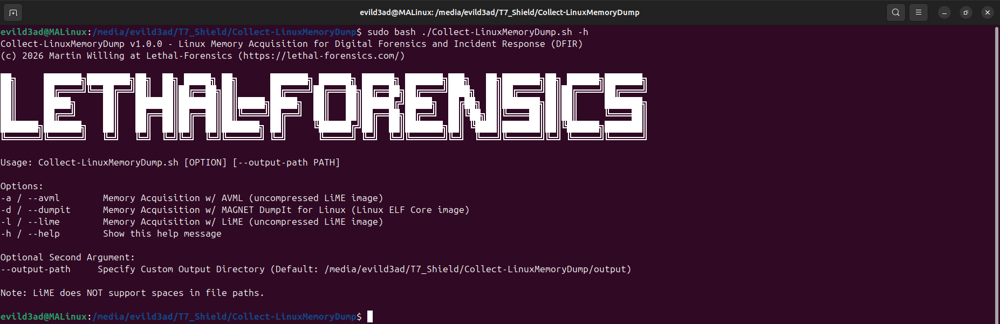
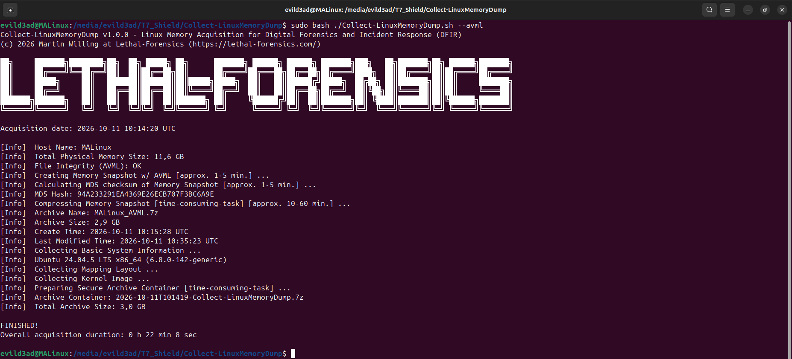
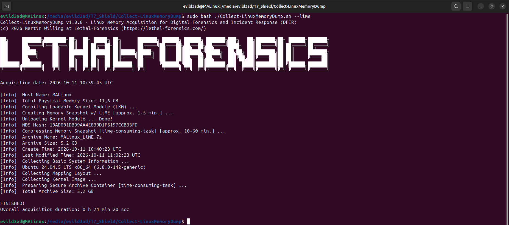

<p align="center"> <a href="https://github.com/LETHAL-FORENSICS/Collect-LinuxMemoryDump/releases/latest"></a>   <a href="https://x.com/LETHAL_DFIR"></a></p>  

# Collect-LinuxMemoryDump
Linux Memory Acquisition for Digital Forensics and Incident Response (DFIR)  

Collect-LinuxMemoryDump.sh is a Shell script utilized to collect a Memory Snapshot from a Linux system (including kernel image and mapping layout) in a forensically sound manner. 

## Features
* Linux Memory Acquisition w/ AVML (uncompressed LiME image) - no on-target compilation required
* Linux Memory Acquisition w/ LiME (uncompressed LiME image) - on-target compilation of the Loadable Kernel Module (LKM)
* Linux Memory Acquisition w/ MAGNET DumpIt for Linux (Linux ELF Core image via /proc/kcore) - no kernel module required
* Support for x86_64 and ARM64 (AVML also supports 32-bit ARM Big-Endian)
* Custom Output Directory (`--output-path`) incl. existence and write-permission check
* Kernel Lockdown Check (acquisition is aborted if Kernel Lockdown is active)
* /proc/kcore Availability Check (DumpIt)
* Safety Guardrail (memory dumps restricted to 256 GB or less)
* Disk Space Check before acquisition (Physical Memory + 12.5% Safety Margin)
* File Integrity Check of the AVML and DumpIt binaries (SHA256)
* MD5 Hash Calculation of the memory snapshot (LiME: in-kernel during acquisition, AVML/DumpIt: md5sum)
* Password-protected 7-Zip archive of the memory snapshot incl. MD5 hash (AES-256, encrypted file names)
* Archive Verification before cleaning up (no data loss if archiving fails)
* Basic System Information Collection (Hostname, OS Release, Uptime, Timezone, Kernel Release)
* Mapping Layout Collection (System.map, Runtime Symbol Table incl. KASLR addresses, Kernel Banner, Kernel Config)
* Kernel Image Collection (vmlinuz, BTF Type Information and Debug Kernel w/ DWARF, if available)
* Secure Archive Container for data exchange w/ forensic analyst (password-protected 7-Zip archive)
* tar Fallback for architectures without 7-Zip (e.g. 32-bit ARM)
* Screen Log (cleaned log file of the entire acquisition incl. duration)
* No data written to the target's local disk (all output is written to the external drive, or to the path given w/ `--output-path`)

## Requirements
* Root privileges (`sudo`)
* Bash
* External drive w/ enough free space (Physical Memory + 12.5% Safety Margin)
* LiME: Kernel headers for the running kernel (e.g. `linux-headers-$(uname -r)`), `make` and `gcc`
* DumpIt: `/proc/kcore` (CONFIG_PROC_KCORE)
* Kernel Lockdown must be disabled (`none`)

## Download
Download the [latest release](https://github.com/LETHAL-FORENSICS/Collect-LinuxMemoryDump/releases/latest) and copy the folder to your external drive (e.g. USB SSD).

> [!NOTE]
> Collect-LinuxMemoryDump includes all external tools by default.  

## Usage

```
sudo bash ./Collect-LinuxMemoryDump.sh [OPTION] [--output-path PATH]
```

  
**Fig 1:** Help-Message  

| Option | Description |
|---|---|
| `-a` / `--avml` | Memory Acquisition w/ AVML (uncompressed LiME image) |
| `-d` / `--dumpit` | Memory Acquisition w/ MAGNET DumpIt for Linux (Linux ELF Core image) |
| `-l` / `--lime` | Memory Acquisition w/ LiME (uncompressed LiME image) |
| `-h` / `--help` | Show the help message |
| `--output-path PATH` | Custom Output Directory (Default: `./output`) |

### Examples
Memory Acquisition w/ AVML:
```
sudo bash ./Collect-LinuxMemoryDump.sh --avml
```

Memory Acquisition w/ LiME:
```
sudo bash ./Collect-LinuxMemoryDump.sh --lime
```

Memory Acquisition w/ MAGNET DumpIt for Linux:
```
sudo bash ./Collect-LinuxMemoryDump.sh --dumpit
```

Memory Acquisition w/ AVML and Custom Output Directory:
```
sudo bash ./Collect-LinuxMemoryDump.sh --avml --output-path /media/user/T7_Shield/Evidence
```

> [!NOTE]
> LiME does NOT support spaces in file paths (script location and output path). Rename the folder/volume if necessary (e.g. `T7 Shield` → `T7_Shield`).

  
**Fig 2:** Automated Creation of Linux Memory Snapshot w/ AVML  

  
**Fig 3:** Automated Creation of Linux Memory Snapshot w/ LiME  

  
**Fig 4:** Automated Creation of Linux Memory Snapshot w/ MAGNET DumpIt for Linux  

## Output
```
output/
└── <HOSTNAME>/
    ├── <TIMESTAMP>-Collect-LinuxMemoryDump.7z      # Secure Archive Container
    └── <TIMESTAMP>-Collect-LinuxMemoryDump_LogFile.txt
```

Contents of the Secure Archive Container:
```
<TIMESTAMP>-Collect-LinuxMemoryDump/
├── Memory/
│   ├── <AVML|LiME|DumpIt>/          # Password-protected 7-Zip archive of the memory snapshot (incl. MD5 hash)
│   ├── Kernel-Image/                # vmlinuz, BTF Type Information, Debug Kernel (if available)
│   └── Mapping-Layout/              # System.map, kallsyms, Kernel Banner, Kernel Config
└── SystemInfo/                      # Basic System Information
```

The timestamp is in UTC (`YYYY-MM-DDThhmmss`).

> [!IMPORTANT]
> The default archive password is `IncidentResponse`. Change `ARCHIVE_PASSWORD` in the script for your own engagements.

## Third-Party Tools
| Tool | Version | License |
|---|---|---|
| [7-Zip](https://www.7-zip.org/) | 26.03 | GNU LGPL + BSD 3-clause + unRAR restriction |
| [AVML](https://github.com/microsoft/avml) | 0.20.0 | MIT |
| [LiME](https://github.com/jtsylve/LiME) | 1.12.0 | GPL-2.0-only |
| [MAGNET DumpIt for Linux](https://github.com/MagnetForensics/dumpit-linux) | 0.1.0 | Apache-2.0 |

The license of each tool is included in its folder under `Tools/`.

## Links
[https://github.com/microsoft/avml](https://github.com/microsoft/avml)  
[https://github.com/jtsylve/LiME](https://github.com/jtsylve/LiME)  
[https://github.com/MagnetForensics/dumpit-linux](https://github.com/MagnetForensics/dumpit-linux)  
[https://github.com/volatilityfoundation/volatility3](https://github.com/volatilityfoundation/volatility3)  
[https://github.com/volatilityfoundation/dwarf2json](https://github.com/volatilityfoundation/dwarf2json)    
[https://github.com/vobst/btf2json](https://github.com/vobst/btf2json)  
[https://github.com/BeanBagKing/VolGolangWrapper](https://github.com/BeanBagKing/VolGolangWrapper)  
[https://github.com/MemNixFS/MemNixFS](https://github.com/MemNixFS/MemNixFS)  
[https://github.com/trailofbits/mquire](https://github.com/trailofbits/mquire)    